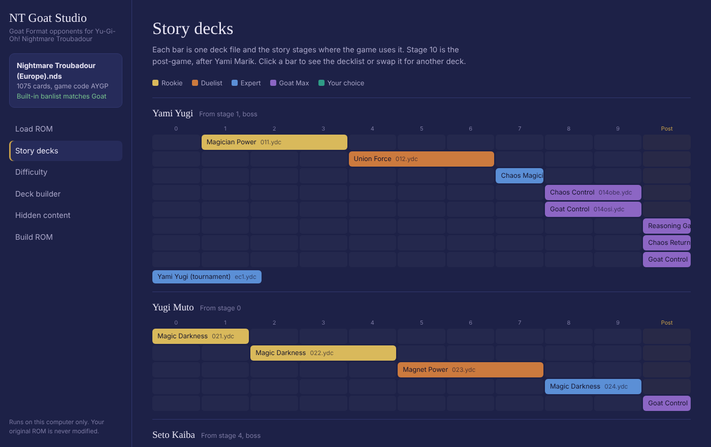
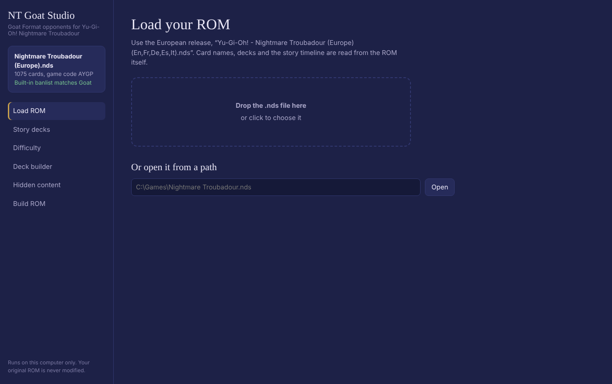
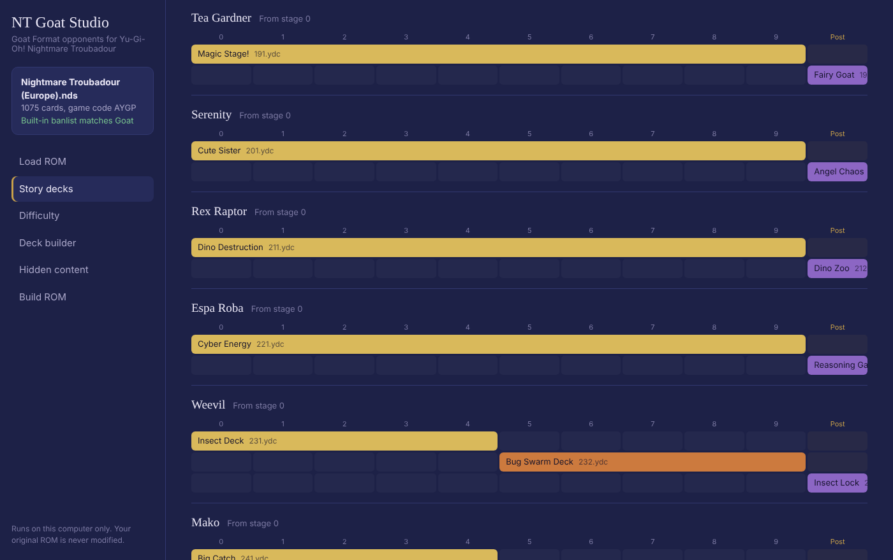
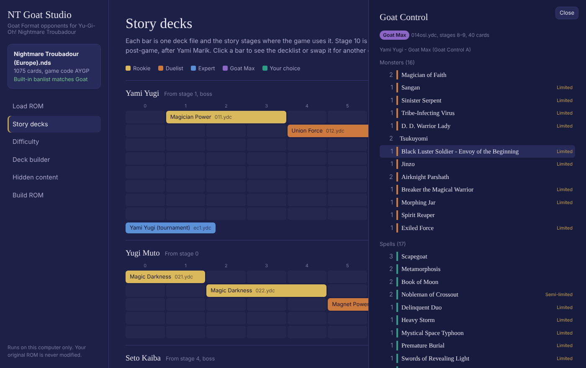
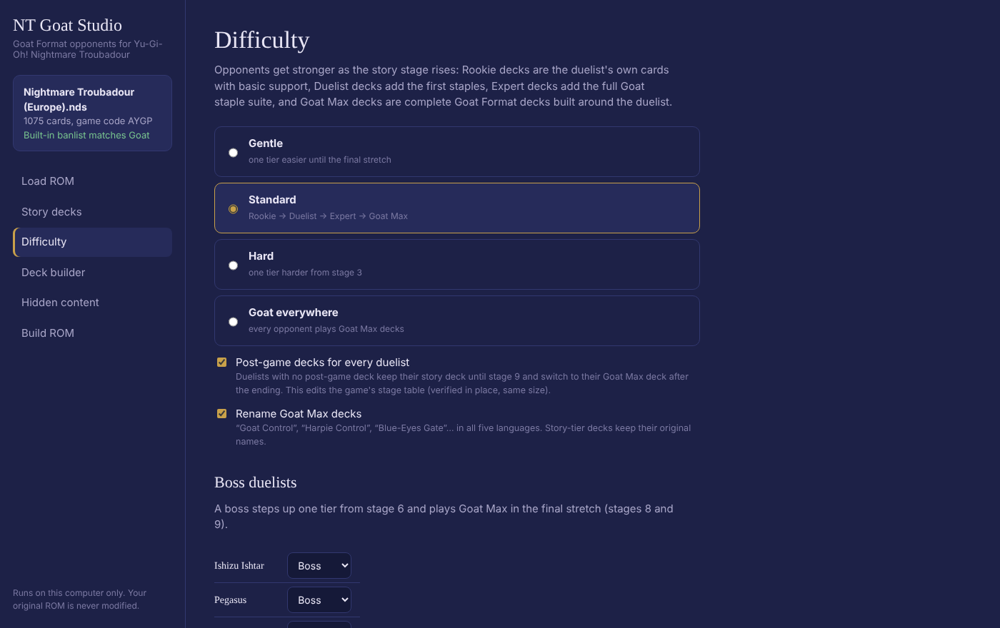
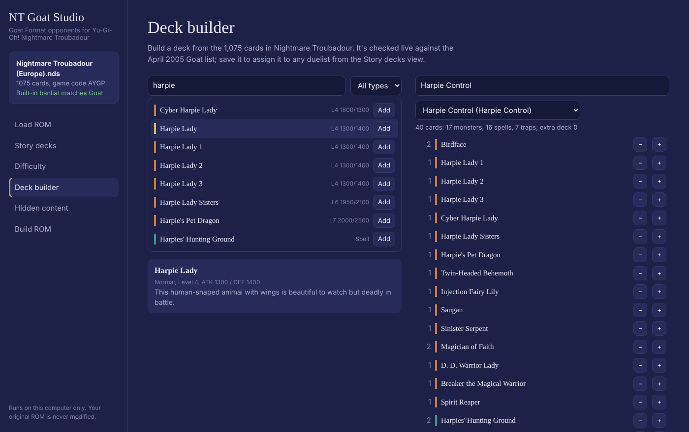
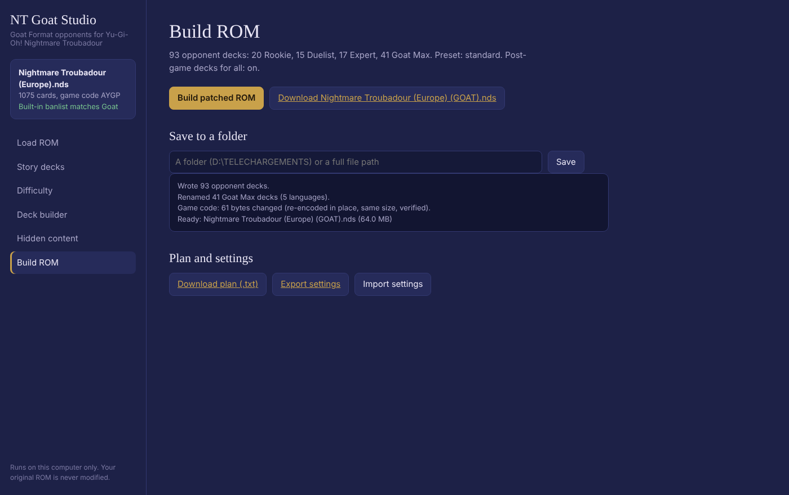
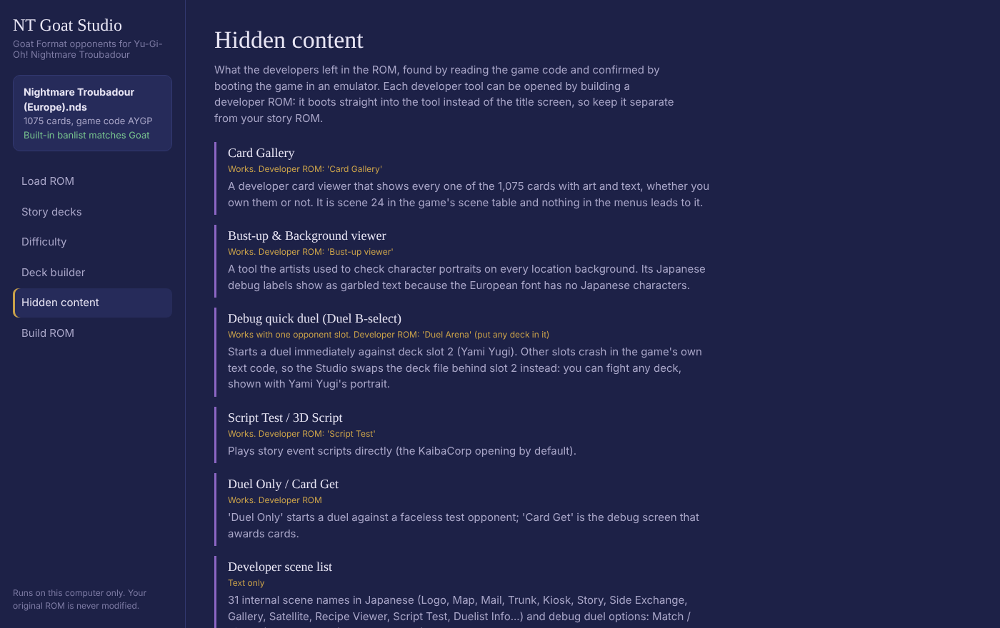

# NT Goat Studio

**Goat Format opponents for Yu-Gi-Oh! Nightmare Troubadour** (Nintendo DS, European release).

Yugi, Kaiba, Pegasus and the rest of the cast play 2005 Goat Format decks (Goat Control, Chaos, Reasoning Gate...) built from the game's own card pool. Each duelist keeps their own style, and the decks get stronger as you progress through the story. A local web interface lets you see every duelist's decks at every story stage, change them, build your own and patch your ROM.

Python 3 only, no extra packages. Runs entirely on your computer.



> ## ⚠️ Legal notice and your responsibility — please read
>
> - **This repository contains no game data.** No ROM, no extracted files, no modified game files: only the tool's code and screenshots of its own interface.
> - **You must own a legal, official copy of Yu-Gi-Oh! Nightmare Troubadour** (the original cartridge) and make the ROM dump yourself, for personal use. Do not download ROMs from the internet.
> - **Never share, upload or distribute** a ROM, extracted game files or the patched ROM this tool produces. They contain copyrighted material.
> - This is an unofficial fan project. It is **not affiliated with, endorsed by or sponsored by Konami or Nintendo**. *Yu-Gi-Oh!*, *Nightmare Troubadour* and all related names, cards, characters and assets are trademarks or copyrights of their owners. Card names appear in the tool because it reads them from your own ROM.
> - **Use at your own risk.** The software is provided "as is" under the MIT license. Always work on copies and keep backups of your ROM and your save file. The author is not responsible for corrupted ROMs or saves, or for how you obtain or use game files.

---

## Contents

- [Features](#features)
- [Requirements](#requirements)
- [Installation](#installation)
- [Guide](#guide)
- [How the difficulty works](#how-the-difficulty-works)
- [Hidden content found in the ROM](#hidden-content-found-in-the-rom)
- [What was tested](#what-was-tested)
- [Advice](#advice)
- [Troubleshooting](#troubleshooting)
- [Command line](#command-line)
- [Security](#security)
- [Credits and license](#credits-and-license)

---

## Features

| Area | What it does |
|---|---|
| **Goat Format decks** | Every one of the 93 CPU opponent decks is replaced. All decks are checked against the April 2005 TCG Forbidden & Limited list before anything is written |
| **Decks that fit each duelist** | Each duelist's decks are built from the signature cards Konami gave them: Tea's fairies, Mai's Harpies, Weevil's insects, Kaiba's Blue-Eyes, Pegasus's Toons... |
| **Difficulty that follows the story** | Rookie → Duelist → Expert → Goat Max, based on the game's own story stages. Four presets: Gentle, Standard, Hard, Goat everywhere |
| **Post-game decks for everyone** | After the ending, every duelist plays a full Goat Format deck in their style |
| **Story decks map** | See which deck each duelist uses at each of the 11 story stages. Click a deck to read it or swap it |
| **Deck builder** | Search the game's 1,075 cards, build decks with a live Goat banlist check, and give them to any duelist |
| **Hidden content** | Developer tools and unused decks found in the ROM, which you can open with a developer ROM build |
| **Safe patching** | Your original ROM is never modified. The patched ROM keeps the exact original size (64 MB) |

### Post-game Goat Max decks

| Duelist | Goat Max deck(s) |
|---|---|
| Yami Yugi, Yugi Muto | Chaos Control, Goat Control, Reasoning Gate, Chaos Return |
| Seto Kaiba | Blue-Eyes Gate (Reasoning / Monster Gate into Blue-Eyes, Cyber-Stein into Ultimate), Chaos Control, Machine Gate |
| Pegasus | Goat Control with Relinquished (Thousand-Eyes Restrict is his card), Reasoning Gate, Chaos Return |
| Joey | Warrior Toolbox, Warrior Beat, Goat Control |
| Mai | Harpie Control |
| Tea / Serenity | Fairy Goat / Angel Chaos |
| Weevil | Insect Lock (Insect Barrier + DNA Surgery) |
| Rex / Mokuba | Dino Zoo / Koala Zoo |
| Mako, Strings, Gansley | Water Goat (A Legendary Ocean, Mother Grizzly) |
| Marik | Lava Control (Lava Golem), Goat Control, Zombie Goat |
| Para | Gate Guardian Gate (Monster Gate into Sanga, Kazejin, Suijin) |
| Solomon, Rare Hunter, Gozaburo | Exodia Library |

The full list, deck file by deck file, is in [docs/DUELISTS.md](docs/DUELISTS.md).

### Cards missing from Nightmare Troubadour

The game has most Goat staples (Scapegoat, Metamorphosis, Thousand-Eyes Restrict, Tsukuyomi, Airknight Parshath, Black Luster Soldier, Dark Magician of Chaos, Reasoning, Monster Gate, Sakuretsu Armor...), but a few are missing. They were replaced as closely as possible:

| Missing | Used instead |
|---|---|
| **Chaos Sorcerer** | Chaos decks run Black Luster Soldier + Dark Magician of Chaos, with Thunder Dragon, Mystic Tomato and Shining Angel to fill the Graveyard |
| Gravekeeper's Spy / Guard, Blade Knight, Asura Priest | Spirit Reaper, a second Tsukuyomi, Exiled Force, D.D. Assailant |
| Sacred Crane (Reasoning Gate) | Airknight Parshath, Sacred Phoenix of Nephthys, Twin-Headed Behemoth |
| Level 4 / 5 fusions for Metamorphosis | Zombie Warrior (Lv3), Alligator's Sword Dragon (Lv5), Ojama King (Lv6), Dark Paladin (Lv8) |

The game's built-in banlist already matches the Goat list for every Goat-legal card. Its only extras are the three God cards and four OCG-only cards that weren't legal in the 2005 TCG anyway. Those cards are never used.

---

## Requirements

| | |
|---|---|
| **Your own game** | A ROM dump of **Yu-Gi-Oh! - Nightmare Troubadour (Europe) (En,Fr,De,Es,It)**, game code `AYGP`, made from your own cartridge |
| **Python** | Python 3.8 or newer (tested with 3.11, 3.12 and 3.13). Nothing else to install: see [requirements.txt](requirements.txt) |
| **Browser** | Any recent browser (Firefox, Chrome, Edge, Safari) for the web interface |
| **To play** | A DS emulator (melonDS, DeSmuME) or a flashcart |
| **System** | Windows, macOS or Linux |

Other releases (US, Japanese) aren't supported: the tool checks the ROM and refuses to patch anything it doesn't recognise.

---

## Installation

### 1. Install Python
- **Windows:** download Python 3 from [python.org/downloads](https://www.python.org/downloads/). In the installer, **tick "Add python.exe to PATH"**. Or run `winget install Python.Python.3.12`.
- **macOS:** `brew install python`, or the installer from python.org.
- **Linux:** usually already installed. Otherwise `sudo apt install python3`.

Check it works by opening a terminal and typing `python --version` (or `python3 --version`).

### 2. Download NT Goat Studio
- On this page, click **Code → Download ZIP** and unzip it anywhere, **or**
- Open the [Releases](../../releases) page and download the latest version, **or**
- `git clone https://github.com/Thomatelot/NT-Goat-Studio.git`

### 3. Start it
- **Windows:** double-click **`Start NT Goat Studio.bat`**.
- **macOS / Linux:** open a terminal in the folder and run `python3 nt_goat_studio.py`.

Your browser opens **http://127.0.0.1:8765**. Keep the terminal window open while you use the Studio; close it to stop the Studio.

---

## Guide

### Step 1 — Load your ROM
Drop your `.nds` file onto the page, click to choose it, or type its full path. The Studio reads the card list, the decks and the story timeline from the ROM itself.



### Step 2 — Look at the story decks
Each duelist has a row with the 11 story stages (0 to 9, then **Post** for the post-game). Each coloured bar is one deck file, placed on the stages where the game uses it. The colour shows the tier:
**yellow** Rookie, **orange** Duelist, **blue** Expert, **purple** Goat Max, **green** a deck you chose.



### Step 3 — Open a deck
Click any bar to see the decklist, grouped into monsters, spells, traps and extra deck, with Limited / Semi-limited marks. Click a card to read its text. At the bottom you can **replace the deck** with any archetype, one of your own decks, or one of the unused developer decks.



### Step 4 — Set the difficulty
Pick a preset, choose who counts as a boss, and decide whether every duelist gets a post-game deck (see [How the difficulty works](#how-the-difficulty-works)).



### Step 5 — Build your own decks (optional)
Search the 1,075 cards, add them with **Add**, and adjust counts with **−** / **+**. You can start from an existing deck. The deck is checked live against the Goat list. **Save deck**, then assign it from the Story decks view.



### Step 6 — Build the ROM
Click **Build patched ROM**, then **Download**, or type a folder (e.g. `D:\Downloads`) to save it there. Under **Plan and settings** you can download the full plan as text and export or import your settings.



### Step 7 — Play
Open the patched `.nds` in your emulator or copy it to your flashcart. Your existing save works: CPU decks are read from the ROM at the start of each duel. Keep the save file name matching the ROM name if your emulator requires it.

---

## How the difficulty works

These facts come from reading the game's code and were checked in an emulator:

- Your save file holds a **story stage from 0 to 10**. Stage 10 is the **post-game**, after Yami Marik.
- For each duelist, a table in the game says which deck **variant** (`xx1.ydc`, `xx2.ydc`...) is used at each stage. At stage 10 the game can also pick a special variant 6 deck (`016.ydc`, `026.ydc`...).
- Decks ending in `obe`, `osi` or `ra` are only used while that duelist holds Obelisk, Slifer or Ra in the story.

The Studio gives each deck file a tier based on the first stage where it's used:

| Stages | Tier | What the deck is |
|---|---|---|
| 0–2 | **Rookie** | The duelist's own cards + basic support. No Pot of Greed or other power cards |
| 3–5 | **Duelist** | + Pot of Greed, Heavy Storm, Book of Moon, Mirror Force, Call of the Haunted... |
| 6–9 | **Expert** | + the full Goat staple suite (Graceful Charity, Delinquent Duo, Snatch Steal, Ring of Destruction, Torrential Tribute...) |
| post-game | **Goat Max** | A complete Goat Format deck in the duelist's style |

- **Bosses** (Yami Yugi, Kaiba, Pegasus, Yami Bakura, Ishizu, Yami Marik, Marik, Noah, Gozaburo) step up one tier from stage 6 and play Goat Max in the final stretch (stages 8–9).
- **Presets:** *Gentle* (one tier easier until the final stretch), *Standard*, *Hard* (one tier harder from stage 3), *Goat everywhere* (every deck is Goat Max).
- **Post-game decks for every duelist** (on by default): some duelists have only two decks, and their second one normally covers mid-game and post-game together. With this option they keep their first deck until stage 9 and switch to their Goat Max deck only after the ending. This is the only change made to the game's code: the stage table is edited inside the compressed game code, re-encoded at the same size and verified. Nothing else in the ROM moves. Side effect: those duelists give slightly less EXP in the middle of the story.

**About "maximum AI":** the game has one CPU engine for every opponent and no AI difficulty setting to raise. The only per-duelist value is their level, which sets the EXP you earn. How hard an opponent is depends entirely on their deck, which is what this tool changes.

---

## Hidden content found in the ROM

Found by reading the game code; each tool below was confirmed by booting it in an emulator.

| Find | Status |
|---|---|
| **Card Gallery**: a developer viewer showing every card with art and text. No menu leads to it | Works |
| **Bust-up & Background viewer**: the artists' tool for checking portraits on every location background. Its Japanese labels show garbled because the European font has no Japanese characters | Works |
| **Debug quick duel**: starts a duel immediately. Only one opponent slot works; the others crash in the game's own text code. The **Duel Arena** build puts any deck you choose into that slot (the opponent shows Yami Yugi's portrait) | Works |
| **Script Test**: plays story event scripts directly | Works |
| **Duel Only / Card Get**: a quick duel against a faceless test opponent / a debug card-award screen | Works |
| **Unused decks**: Ojama Lock with Ojama King, Final Countdown stall, Stone wall, a test deck, and the **E3 2005 demo decks** (Yami Yugi, Kaiba, Joey, player) | Selectable in the Studio |
| Developer scene list and debug duel options in Japanese (Match / Single / 20-turn duel / Shadow Game / Noah & Gozaburo), full Japanese and English BGM list | Text only |
| Unused graphics (a US title logo, extra map backgrounds), build files listing Photoshop sources | Files only |
| Clerk and Roland have names but no duel data; nine empty name slots after Bakura | No duel data |

To use the tools, go to **Hidden content → Build a developer ROM**. A developer ROM boots straight into the chosen tool **instead of the title screen**, so you can't play the story with it. Keep it separate from your story ROM.



---

## What was tested

| Check | Result |
|---|---|
| All 4 presets, with and without the post-game option, built from the real European ROM | ✅ every deck re-read card for card, ROM stays exactly 64 MB |
| Patched ROM booted in the melonDS emulator core: title screen, New Game, story opening | ✅ |
| New stage table present in the game's memory after boot | ✅ |
| Duel against Tea's post-game Fairy Goat deck (Duel Arena build) | ✅ the CPU summoned Shining Angel, attacked and set cards |
| Duel against Harpie Control (Duel Arena build) | ✅ the CPU set its back row |
| Card Gallery, Bust-up viewer, Script Test, Duel Only, Card Get developer builds | ✅ boot and run |
| Version 1 patch (all opponents on Goat decks) played in-game by the author | ✅ new decks, cards handled well by the CPU |
| **A full playthrough of the story with version 2** | ❌ not done yet |
| How well the CPU plays Metamorphosis / Thousand-Eyes Restrict (Konami's own CPU decks never used them) | ❓ not verified |
| US / Japanese releases | ❌ not supported |

---

## Advice

- **Keep backups.** Keep your original ROM and copy your save file before playing a patched ROM.
- **Start with Standard.** If the early game is still too hard, try **Gentle**. If you already know Goat Format well, try **Hard**.
- **Leave "Post-game decks for every duelist" on** if you want every rematch after the ending to be a real Goat duel.
- **Build your own deck in Goat Format too.** Opponents with Goat Max decks are tough. The in-game Forbidden & Limited list already matches Goat, so the deck editor enforces the right limits.
- **Test a deck before a long session:** build a **Duel Arena** developer ROM with that deck as the opponent.
- **Share settings, not ROMs.** *Export settings* gives you a small `.json` file with your options, deck swaps and custom decks. You can share it safely; it contains no game data.
- If a duelist feels too weak or too strong, change who counts as a boss on the Difficulty page, or swap that one deck in the Story decks view.

---

## Troubleshooting

| Problem | Fix |
|---|---|
| Double-clicking the `.bat` closes immediately / "python is not recognized" | Python isn't installed or isn't in PATH. Reinstall it and tick **Add python.exe to PATH**, or run `py nt_goat_studio.py` |
| "This ROM does not look like Yu-Gi-Oh! Nightmare Troubadour" | Use the European release (game code `AYGP`), unmodified. A ROM already patched by another tool may not be recognised |
| "Header checksum mismatch" | The file is damaged or isn't a `.nds` ROM. Dump it again |
| "Missing or wrong session token" | You opened an old Studio tab after restarting it. Reload the page |
| The browser doesn't open | Open **http://127.0.0.1:8765** yourself |
| "Address already in use" | Another copy of the Studio is running. Close it, or start with `python nt_goat_studio.py --port 9000` |
| "Permission denied" when saving | Choose a folder you can write to (Downloads, Documents), or use the **Download** button |
| A deck shows in red in the Story decks view | It breaks the Goat list or has a wrong card count. Open it to see the reason; the ROM won't build until it's fixed |
| The emulator doesn't find my save | Rename the save to match the new ROM name (e.g. `... (GOAT).sav`) |

---

## Command line

The web interface is the main way to use the tool, but everything also works from a terminal:

```
python nt_goat_studio.py                                  # start the web interface
python nt_goat_studio.py --port 9000 --no-browser         # other port, don't open the browser
python nt_goat_studio.py build  ROM.nds OUT.nds           # patch with the default settings
python nt_goat_studio.py build  ROM.nds OUT.nds --preset gentle|standard|hard|goat [--no-postgame]
python nt_goat_studio.py report ROM.nds plan.txt          # write the full plan
python nt_goat_studio.py build  ROM.nds DEV.nds --dev gallery|bustup|script|arena|duelonly|cardget
```

`nt_goat_patcher.py` is version 1 of the tool, kept for reference: every opponent gets a Goat Max deck from the start, with no story progression. It runs with a small Tkinter window or `python nt_goat_patcher.py -h`.

### Files

| File | Role |
|---|---|
| `nt_goat_studio.py` | Local web server and command line |
| `web/index.html` | The web interface |
| `studio_core.py` | Story timeline, tiers, deck generation, patching |
| `profiles.py` | Duelist profiles (theme cards, bosses, Goat Max decks) and tier staples. **Edit this to change a duelist's style** |
| `nt_goat_patcher.py` | ROM file system, card database, Goat archetypes, banlist checks (and version 1) |
| `blz_patch.py` | Same-size re-encoding of the compressed game code |
| `docs/TECHNICAL.md` | How the game stores decks and story progression, for curious modders |

---

## Security

- The Studio listens on **127.0.0.1 only**: other computers on your network can't reach it.
- Every request must carry a random **session token** that only the Studio page knows, and requests addressed to other host names are refused. Other websites open in your browser can't control it.
- Nothing is downloaded or uploaded to the internet. The tool makes no network requests.
- Your ROM is only read; results are written to a new file you choose.

Details and how to report a problem: [SECURITY.md](SECURITY.md).

---

## Credits and license

- Created by **Thomatelot**, developed with the help of Claude (Anthropic).
- Goat Format banlist and 2005 decklists researched from [GoatFormat.com](https://www.goatformat.com/) and [YGOPRODeck](https://ygoprodeck.com/).
- Code under the **MIT license**, see [LICENSE](LICENSE). The license covers this tool's code only. It grants no rights over the game or its data.

If you enjoy it, a ⭐ on the repository is appreciated. Bug reports are welcome in [Issues](../../issues); please never attach ROMs or game files.
